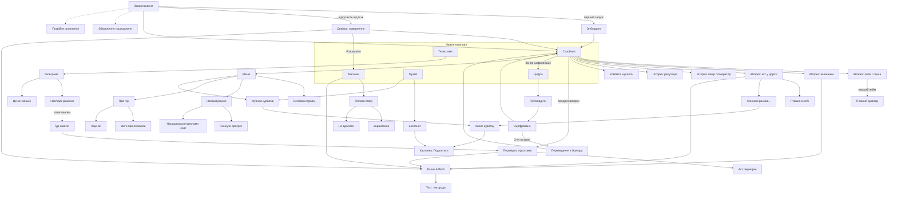

# Екрани

Карта має 81 позицію: 71 входить у MVP, 9 відкладено, ATT не показуємо. Дизайнерам треба намалювати 64 позиції MVP і 188 станів. Основа: GDD, 11 мокапів, пісочниця економіки v4 і журнал рішень від 9.10.2026.

## Підсумок

| Тип | Що це | У MVP |
| --- | --- | --- |
| вкладка | Корінь нижньої навігації | 5 |
| екран | Повний екран поверх вкладок | 19 |
| модалка | Вікно поверх екрана | 15 |
| шторка | Панель знизу (bottom sheet) | 12 |
| тост або банер | Коротке повідомлення | 10 |
| оверлей | Шар поверх інтерфейсу: коуч, дзвінок | 2 |
| системне | Малює ОС або SDK | 8 |
| **Разом** |  | **71** |

Системні вікна, крім сплешу, не малюємо, тож дизайнерам лишається 64 позиції. Мокапи є для 11 із них: Main треба перемалювати, ще 7 виправити (розділ «Прогалини й рішення»). Нових макетів потрібно 53.

У розділі «Стани» описано 188 станів. Перевірки на SE, довгий текст, масштаб шрифту й Reduce Motion стосуються кожного екрана й до підрахунку не входять.

## Інвентар

81 позиція у 12 групах за місцем у грі. Тип — як у таблиці «Підсумок». У стовпці «Мокап» стоїть назва артборда, якщо він є.

### Запуск і система

| ID | Назва | Тип | Призначення | Звідки | Куди | Обсяг | Мокап |
| --- | --- | --- | --- | --- | --- | --- | --- |
| `splash` | Сплеш | системне | Статичне зображення (кіт на сейфі), поки вантажиться JS | запуск | `boot` | MVP | немає |
| `boot` | Завантаження | екран | Шрифти, збереження, міграція схеми; «неписана істина», якщо довше 1 с | `splash` | `onb-title` / `offline-return` / `main` / `save-error` / `force-update` | MVP | немає |
| `save-error` | Збереження пошкоджене | екран | Відновити з резервної копії (2 останні знімки MMKV) або почати заново; звіт у Sentry | `boot` | `main` / `onb-title` | MVP | немає |
| `force-update` | Потрібне оновлення | екран (блокує) | Версія нижча за мінімальну зі статичного JSON на CDN (бекенду немає) | `boot` | стор | MVP (мінімум) | немає |
| `soft-update` | Є оновлення | модалка | Можна відкласти | `boot` | стор / `main` | пізніше | немає |
| `clock-toast` | Годинник змінено | тост | Пояснює, чому офлайн-дохід не нараховано: годинник перевели назад | `boot` | — | MVP | немає |
| `no-net-toast` | Немає зв'язку | тост | Реклама й магазин недоступні, гра працює далі | реклама, магазин | — | MVP | немає |

### Онбординг (перша сесія)

| ID | Назва | Тип | Призначення | Звідки | Куди | Обсяг | Мокап |
| --- | --- | --- | --- | --- | --- | --- | --- |
| `onb-title` | Титул «Наказ № 1» | екран | Старт без реєстрації й дозволів | `boot` (перший запуск) | `onb-intro` | MVP | Onb-Title |
| `onb-intro` | Вступ: Начштабу «Кава» | екран | Репліки по одному тапу, «Пропустити» | `onb-title` | `onb-callsign` | MVP | Onb-Intro |
| `onb-callsign` | Позивний | екран | Готові варіанти або свій; стать протагоніста: він / вона | `onb-intro` | `callsign-input`, `onb-first-act` | MVP | Onb-Callsign |
| `callsign-input` | Свій позивний | шторка з клавіатурою | Введення, довжина 2–16, стоп-слова (мат, «УПА», «ЗСУ…») | `onb-callsign`, `profile` | назад | MVP | немає |
| `onb-first-act` | Перший акт: Ліна і Пташка | екран | 8 тапів, ПОГОДЖЕНО, дрон злітає, ×2 | `onb-callsign` | `main` + `coach` | MVP | Onb-FirstAct |
| `coach` | Підказка з підсвіткою | оверлей | Кроки 6–10: покращення, найм, телеграма, реклама; один крок, одна дія | `main`, `tg-list`, `boosts-sheet` | підсвічений елемент | MVP | немає |
| `clerk-first` | Перший діловод | модалка | Момент автоматизації: «Тепер підписи йдуть, поки ти п'єш каву» | перший найм в `unit-sheet` | `main` | MVP | немає |
| `call` | Дзвінок «Археологу» | оверлей (екран дзвінка) | Скриптові дзвінки: бонус з архіву, натяк на перевірку | крок 9, перед 1-ю перевіркою, 1-ю цифровізацією, переходом на Р2 | `event-toast`, `insp-warning` | MVP (лише скрипт) | немає |
| `ad-offer-first` | Перша пропозиція реклами | модалка | Пояснює ×2 на 4 год до першого ролика | крок 10 | `consent-ump` (ЄЕЗ, UK, CH) → `ad-player` / закрити | MVP | немає |
| `push-preprompt` | Сповіщення: наш запит | шторка | «Скажемо, коли склад заповниться або приїде комісія» | після кроку 10; `settings` | `push-system` / закрити | MVP | немає |
| `push-system` | Системний запит сповіщень | системне | iOS; Android 13+ (POST\_NOTIFICATIONS) | `push-preprompt` | — | MVP | — |

### Вкладка «Стройова»

| ID | Назва | Тип | Призначення | Звідки | Куди | Обсяг | Мокап |
| --- | --- | --- | --- | --- | --- | --- | --- |
| `main` | Стройова: конвеєр | вкладка | Окремі блоки «Потоки» і «Погодження», вузьке місце, плитки паперу, генератора й репутації, банери подій, постійна тап-зона (печатка на картці «Стройова частина») | вкладка; після онбордингу й офлайну | усі шторки нижче, `insp-prep`, `digital` | MVP | Main (структура застаріла, див. «Прогалини й рішення») |
| `unit-sheet` | Потік або ланка: деталі | шторка | Рівень, виробіток, ціна, купити ×1 / ×10 / до віхи, віха ×2 кожні 25 рівнів, найм діловода | картка на `main` | `clerk-first` | MVP | немає |
| `unit-unlock` | Новий потік або ланка | модалка | Хто приносить ці документи й навіщо; один раз на потік, Казначейство, потік Р2 | купівля 1-го рівня; `level-up` | `main` | MVP | немає |
| `boosts-sheet` | Множники | шторка | Усі множники: Пташка, буст за рекламу, перевірка ×3, повний бак ×1,25, цифрові бали, «Без реклами», музей; кнопка буста | чип множника на `main` | `ad-player`, `shop` | MVP | немає |
| `race-sheet` | Акт у дорозі | шторка | Маршрут акта, таймер ресурсу в годинах і хвилинах, прискорення: діловод, цифра, реклама −50% | картка гонки на `main` | `ad-player`, `race-won`, `race-lost` | MVP | Main (лише картка) |
| `gift-arrived` | Ліна привезла подарунок | модалка | Старт гонки: що привезли і скільки воно прослужить | подія | `race-sheet` | MVP | немає (основа — Onb-FirstAct) |
| `race-won` | Пташка в небі | модалка | Печатка, ×2 на час служби | гонка встигла | `main` | MVP | Onb-FirstAct (стан «готово») |
| `race-lost` | Списано раніше, ніж поставлено на облік | модалка | Запис у Журнал курйозів, без штрафу, «Поділитися» | гонка не встигла | `curio-detail`, `main` | MVP | немає |
| `kombat-sheet` | Комбата шукають | шторка | Чекати або відправити посильного; «Резолюції» стоять | подія, картка ланки | `main` | MVP | немає |
| `resource-sheet` | Папір і генератор | шторка | Запас паперу й пального, звідки береться, на що йде; «Заправити» безкоштовно, бака вистачає на \~6 год, повний бак дає ×1,25 | плитки паперу й генератора, банер «Бак порожній» | `main` | MVP | немає |
| `reputation-sheet` | Репутація | шторка | Рівень словом (низька / норма / висока), що дає (рідші перевірки), що знижує (відписки) | плитка репутації, `tg-result` | — | MVP | немає |
| `digit-hint` | Час цифровізуватися | банер | Наступна покупка далі ніж за 4 год | `main` | `digital` | MVP | немає |
| `cat-toast` | Кіт Сейф | тост | Бонус за тап раз на годину | кіт на `main` | — | MVP | немає |
| `event-toast` | Подія або вісточка | тост | «Пташка: 40 вильотів», новий експонат, найм, бонус дзвінка | різні | `note-detail`, `journal-new` | MVP | немає |
| `menu` | Меню | шторка | Особова справа, Журнал курйозів, Налаштування, Про гру | кнопка меню на `main` | `profile`, `curios`, `settings`, `about` | MVP | немає (кнопка є в Main) |

### Повернення в гру

| ID | Назва | Тип | Призначення | Звідки | Куди | Обсяг | Мокап |
| --- | --- | --- | --- | --- | --- | --- | --- |
| `offline-return` | Довідка про роботу за час відсутності | екран (модально над `main`) | Офлайн-дохід, підсумок подій, ×2 за рекламу (до 3 разів на день), рядок «Щоденника стройовика» | запуск або повернення з фону після ≥ 5 хв; пуш «склад повний» | `main`, `ad-player`, `shop` | MVP | Offline |

### Вкладка «Телеграми»

| ID | Назва | Тип | Призначення | Звідки | Куди | Обсяг | Мокап |
| --- | --- | --- | --- | --- | --- | --- | --- |
| `tg-list` | Вхідні | вкладка | Телеграми (нові, на виконанні, у шухляді, архів) і записки | вкладка, бейдж | `tg-detail`, `note-detail` | MVP | немає |
| `tg-detail` | Телеграма | екран | Текст, строки по рівнях, 2–4 відповіді, «Це не смішно», «Поділитися» | `tg-list`, тост, пуш | `tg-result`, `tg-flag`, `share-card` | MVP | Telegram |
| `tg-result` | Наслідок рішення | модалка | Штамп і що змінилося: репутація, ланка ×0,5 на 1 год, шанс позапланової перевірки | `tg-detail` | `tg-list`, `insp-warning`, `journal-new` | MVP | немає |
| `tg-flag` | Це не смішно | шторка | Причина (необов'язково), подяка; подія в PostHog | `tg-detail` | назад | MVP | немає |
| `note-detail` | Записка | шторка | Вісточки Пташки, записки Ліни, підсумок дзвінка; без вибору | `tg-list`, `event-toast` | назад | MVP | немає |

Подію «Новий наказ скасовує старий» робимо як тип телеграми (варіант `tg-detail`), окремого екрана не треба.

### Перевірка

| ID | Назва | Тип | Призначення | Звідки | Куди | Обсяг | Мокап |
| --- | --- | --- | --- | --- | --- | --- | --- |
| `insp-warning` | Їде комісія | модалка | Уперше з Тумбочкіним і правилами; далі лише банер на `main` і пуш | таймер подій, `tg-result` | `insp-prep` | MVP | немає (банер є в Main) |
| `insp-prep` | Перевірка: підготовка | екран | Таймер, чекліст за підписи, готовність %, «Усе за рекламу» | банер на `main`, пуш | `ad-player`, `insp-result` | MVP | Inspection |
| `insp-result` | Акт перевірки | модалка (документ) | Пройшли: ×3 на 2 год, можливий експонат. Провалили: простій 1 год | таймер дійшов до 0 у грі; інакше блок в `offline-return` | `main`, `journal-new`, `rating` | MVP | немає |

### Вкладка «Цифра»

| ID | Назва | Тип | Призначення | Звідки | Куди | Обсяг | Мокап |
| --- | --- | --- | --- | --- | --- | --- | --- |
| `digital` | Цифровізація | вкладка | Прогноз балів, новий множник, що скасується, що обнулиться, доріжка рівнів, лічильник «Цифровізацій на рівні: 1 з 3» | вкладка, `digit-hint` | `digit-confirm` | MVP | Digital |
| `digit-confirm` | Підтвердити цифровізацію | модалка | Незворотність, підсумок обнулення | `digital` | `digit-result` | MVP | немає |
| `digit-result` | Оцифровано | екран (церемонія) | Штамп, бали, журнали летять у музей | `digit-confirm` | `main` (скинутий), `level-up`, `journal-new`, `rating` | MVP | немає |
| `level-up` | Наказ про переведення в бригаду | екран | Штаб у колишньому будинку культури, 4-та ланка «Казначейство», 5-й потік «Накази по частині», «Комісія командування» | `digit-result` після 3-ї цифровізації на Р1 | `main` Р2 + `coach` + `unit-unlock` | MVP | немає |

### Вкладка «Музей»

| ID | Назва | Тип | Призначення | Звідки | Куди | Обсяг | Мокап |
| --- | --- | --- | --- | --- | --- | --- | --- |
| `museum` | Музей скасованих журналів | вкладка | Сегменти «Журнали» і «Курйози»; обкладинки, лічильник «з 8», фільтри, бонус колекції | вкладка | `journal-detail`, `curios` | MVP | Museum |
| `journal-detail` | Експонат | шторка | Обкладинка, історія скасування, рідкість, бонус, звідки береться, «Поділитися» | `museum` | `share-card` | MVP | немає |
| `journal-new` | Новий експонат | модалка | Розкриття журналу після цифровізації, телеграми чи перевірки | `digit-result`, `tg-result`, `insp-result` | `journal-detail` / закрити | MVP | немає |
| `curios` | Журнал курйозів | екран (сегмент музею) | Усі телеграми й списані дрони за хронологією | `museum`, `menu` | `curio-detail` | MVP | немає |
| `curio-detail` | Запис курйозу | екран | Документ із печаткою, «Поділитися» | `curios`, `race-lost` | `share-card` | MVP | немає |
| `share-card` | Картинка для поширення | модалка (прев'ю) | Документ 1080×1350 з печаткою й назвою гри: головний органічний канал | `curio-detail`, `journal-detail`, `tg-detail` | `share-system` | MVP | немає |
| `share-system` | Меню «Поділитися» | системне | — | `share-card` | — | MVP | — |

### Вкладка «Магазин» і покупки

| ID | Назва | Тип | Призначення | Звідки | Куди | Обсяг | Мокап |
| --- | --- | --- | --- | --- | --- | --- | --- |
| `shop` | Магазин | вкладка | Буст за рекламу; «Без реклами» 199 ₴, «Стартовий набір» 79 ₴, «Розширене сховище» 99 ₴; «Відновити покупки». Без таймерів, бейджа «Найпопулярніше» і згадок фонду | вкладка, `offline-return`, `boosts-sheet` | `iap-system`, `ad-player`, `restore-toast` | MVP | Shop |
| `starter-offer` | Стартовий набір | модалка | Одноразова пропозиція: 50 000 підписів і бак генератора на 12 год замість 6, без таймера | тригер (після 1-ї перевірки) | `iap-system` | MVP | немає |
| `iap-system` | Оплата App Store / Google Play | системне | — | `shop`, `starter-offer` | `iap-success`, `iap-error` | MVP | — |
| `iap-success` | Зараховано | модалка | Що змінилося, наприклад «×1,3 уже діє» | `iap-system` | `shop` | MVP | немає |
| `iap-error` | Покупка не пройшла | тост | Помилка або «очікує підтвердження» (Ask to Buy, pending); скасування проходить тихо | `iap-system` | `shop` | MVP | немає |
| `restore-toast` | Відновлення покупок | тост | «Відновлено: Без реклами» або «Покупок не знайдено» | `shop`, `settings` | — | MVP | немає |

### Реклама за винагороду (спільний потік для 5 місць)

| ID | Назва | Тип | Призначення | Звідки | Куди | Обсяг | Мокап |
| --- | --- | --- | --- | --- | --- | --- | --- |
| `ad-player` | Ролик AdMob | системне (SDK) | Окремого підтвердження немає: кнопка вже каже «Реклама 30 с → ×2 на 4 год». З «Без реклами» ролика немає, кнопка «Забрати» | `boosts-sheet`, `offline-return`, `race-sheet`, `insp-prep`, `shop` | `ad-reward` / `ad-no-reward` | MVP | — |
| `ad-reward` | Нагороду зараховано | тост | — | `ad-player` | — | MVP | немає |
| `ad-no-reward` | Ролик закрито раніше | тост | Нагороди немає, спроба не згоріла | `ad-player` | — | MVP | немає |
| `ad-unavailable` | Реклама недоступна | тост | Немає ролика, немає мережі або вичерпано ліміт; кнопка неактивна, причина написана словами | кнопки «за рекламу» | — | MVP | немає |

### Профіль, налаштування, приватність, «Про гру»

| ID | Назва | Тип | Призначення | Звідки | Куди | Обсяг | Мокап |
| --- | --- | --- | --- | --- | --- | --- | --- |
| `profile` | Особова справа | екран | Позивний, посада, рівень, бали, лічильники (телеграми, перевірки, дрони), «Щоденник стройовика» | `menu` | `callsign-input` («Рапорт на зміну позивного») | MVP (мінімум) | немає |
| `settings` | Налаштування | екран | Звук, вібрація, сповіщення за типами, анонімна статистика (вимикач), налаштування реклами, відновити покупки, скинути прогрес | `menu` | `privacy-options`, `reset-confirm`, `restore-toast`, налаштування ОС | MVP | немає |
| `reset-confirm` | Скинути прогрес | модалка | Два кроки; покупки не зникають | `settings` | `onb-title` | MVP | немає |
| `consent-ump` | Згода на рекламу (Google UMP) | системне | Лише ЄЕЗ, UK, CH; показуємо перед першим роликом, а не на старті | `ad-offer-first` | `ad-player` | MVP | — |
| `privacy-options` | Налаштування реклами (UMP) | системне | Повторний вибір; пункт у `settings` є лише там, де його вимагають | `settings` | — | MVP | — |
| `att` | Дозвіл на відстеження (ATT) | системне | Не показуємо (рішення 18) | — | — | не робимо | — |
| `rating` | Оцінка в сторі | системне | SKStoreReview / In-App Review після позитивного моменту, без нашого пре-промпту | `insp-result` (пройшли), `digit-result` | — | MVP | — |
| `about` | Про гру | екран | Автор, ілюстратор, «\[N\]% чистого виторгу розробник перераховує на \[ФОНД\]», звіти, політика приватності, ліцензії, контакт, версія | `menu` | `fund-reports`, `licenses`, браузер | MVP | немає |
| `fund-reports` | Звіти про перекази | екран | Місяці, суми, квитанції (посилання на сайт) | `about` | браузер | MVP | немає |
| `licenses` | Ліцензії | екран | OFL для шрифтів, CC0 для звуків, бібліотеки | `about` | — | MVP | немає |

### Пізніше

| ID | Назва | Тип | Призначення | Звідки | Обсяг |
| --- | --- | --- | --- | --- | --- |
| `archive` | Архів попередника | екран | Таблиці Археолога: колекція й підказки до сліду | `call`, `museum` | пізніше |
| `move-game` | Переїзд | екран (міні-гра 20 с) | Скласти ящики у вантажний бус | подія рівня | пізніше |
| `player-telegram` | Розкажи свій абсурд | екран (форма) | Телеграми від гравців, потрібен бекенд | `about` | пізніше |
| `wardrobe` | Косметика | екран | Бліндаж, шеврони, кіт | `profile`, `shop` | пізніше |
| `season` | Сезонний пропуск | екран | — | `shop` | пізніше |
| `leaderboard` | Лідерборд | екран | Нескінченний режим | `digital` | пізніше |
| `cloud-save` | Хмарне збереження | екран | Вхід і синхронізація | `settings` | пізніше |
| `language` | Мова | шторка | EN після UA | `settings` | пізніше |

## Стани

Для MVP треба намалювати 188 станів. Перевірки нижче стосуються кожного екрана й до підрахунку не входять.

- **iPhone SE 375×667.** Мокапи зроблені під 390×844, на SE висота менша на 177 px. Стовпець «SE і довгий текст» показує, де це ламається.
- **Довгий текст.** Фікстури: «Книга обліку руху осіб, які харчуються», «Перерахувати сержантів десятьма формулами», «Зареєструвати й покласти в шухляду», позивний на 16 знаків, числа «999,99 млрд» і «12,3 ab».
- **Масштаб шрифту.** Ліміт `maxFontSizeMultiplier` 1,3; у документах (IBM Plex Mono / TT2020) шрифт вище не масштабується.
- **Reduce Motion.** Печатка б'є без тремтіння екрана. Вимкнена вібрація прибирає haptics.
- **Колір.** Червоний лише для тривог і завжди зі словом або іконкою. Штампи синьо-фіолетові: #4A3D9E на папері, #C2BAF8 на темному; паста підпису #233D8C.

| ID | Стани для малювання | К-сть | Р1 / Р2 | SE і довгий текст |
| --- | --- | --- | --- | --- |
| `splash` | одне | 1 | — | — |
| `boot` | коротке (лише лого); довге з «неписаною істиною»; міграція («Переносимо особову справу…») | 3 | — | істина до 2 рядків |
| `save-error` | є резервна копія; копії немає (лише «Почати заново» і «Надіслати звіт») | 2 | — | — |
| `force-update` | одне | 1 | — | — |
| `onb-title` | одне | 1 | — | печатка не налазить на кнопку |
| `onb-intro` | репліка 1; відповідь гравця; репліка 3 | 3 | — | репліка ≤ 2 рядки |
| `onb-callsign` | обрано готовий; вписано свій; вибір статі (він / вона) | 3 | — | варіанти позивних, перемикач статі й поле книги на SE без скролу |
| `callsign-input` | порожньо; валідно; помилка (довжина, стоп-слово) | 3 | — | клавіатура закриває пів SE |
| `onb-first-act` | 0/8; у процесі; 8/8, печатка і дрон | 3 | — | — |
| `coach` | крок 6 (покращення); 7 (найм); 8 (вкладка Телеграми); 8 (вибір відповіді); 10 (буст); Р2: Казначейство | 6 | крок Р2 | підказка не закриває ціль |
| `clerk-first` | одне | 1 | — | — |
| `call` | виклик; репліки; бонус отримано | 3 | — | — |
| `ad-offer-first` | ролик готовий; ролик недоступний | 2 | — | — |
| `push-preprompt` | одне | 1 | — | — |
| `main` | перша сесія (лише Рапорти + 3 ланки, решта потоків замкнені); звичайний Р1, вузьке місце в погодженнях; вузьке місце в потоках; ланка «вручну», без діловода; ланка сповільнена: ×0,25 (комбата шукають, до 30 хв) чи ×0,5 (провалена перевірка, телеграма на виконанні); бак порожній (бонусу ×1,25 немає, банер «Заправити»); папір 0 (конвеєр працює, телеграми з витратою паперу чекають); гонка йде; гонка «не встигаєте»; перевірка з таймером; кілька множників (чип «×6»); банер цифровізації; Р2 | 13 | Р2: шапка «Бригада · штаб у колишньому будинку культури», 4 ланки з Казначейством, 5-й потік, інший фон | шапка й ресурси ≤ 200 px, конвеєр скролиться, таббар закріплений |
| `unit-sheet` | потік; ланка; не вистачає підписів («ще 2 хв»); перемикач ×1 / ×10 / до віхи; перед віхою (×2 на 25-му); діловод не найнятий; діловод найнятий (ім'я, прізвисько); ланка як вузьке місце (пояснення «дохід = менше з двох») | 8 | Р2: Казначейство | «Резолюції комбата» в 1 рядок |
| `unit-unlock` | потік Р1 (один макет на три тексти); Казначейство; потік Р2 | 3 | 2 стани лише Р2 | — |
| `boosts-sheet` | лише постійні множники; буст з таймером; буст накопичено на 12 год (кнопка неактивна); «Без реклами»: «Забрати» без ролика; реклама недоступна або ліміт | 5 | — | список до 7 рядків |
| `race-sheet` | встигаєте; не встигаєте (червоне + слово); прискорено; ліміт 3/3 | 4 | маршрут Р2 із Казначейством | маршрут із 5 кроків у 343 px |
| `gift-arrived` | одне (дрон, лопати, генератор: різні ілюстрації) | 1 | — | — |
| `race-won` | дрон ×2; інший подарунок | 2 | — | — |
| `race-lost` | одне | 1 | — | — |
| `kombat-sheet` | чекаємо (таймер); посильного відправлено | 2 | — | — |
| `resource-sheet` | папір у нормі; папір 0 (конвеєр працює); бак > 20%, ×1,25 діє; бак ≤ 20%, звичайна швидкість і «Заправити»; щойно заправлено (6 год, зі стартовим набором 12) | 5 | — | — |
| `reputation-sheet` | низька; норма; висока (словом, не лише кольором) | 3 | — | — |
| `digit-hint` | одне | 1 | — | банер в 1 рядок |
| `cat-toast` | бонус; кіт спить (кулдаун, стан на `main`) | 2 | — | — |
| `event-toast` | один компонент, 4 іконки | 1 | — | 2 рядки максимум |
| `menu` | одне (бейдж «нове» біля Журналу курйозів) | 1 | — | — |
| `offline-return` | звичайний, з ×2 за рекламу; «Без реклами»: одна кнопка «Забрати ×2»; ліміт 3/3, лише «Забрати»; реклама недоступна; сховище переповнене («зараховано 8 з 13 год» + «Розширити»); без діловодів: «Стройова стояла», 0 підписів, підказка найняти; з подіями (перевірка пройдена / провалена, дрон введено / списано, нові телеграми); відсутність < 5 хв: тост замість екрана | 8 | Р2: «Бригада» в шапці довідки | довідка скролиться, кнопки закріплені внизу |
| `tg-list` | порожньо («Телеграм немає. Підозріло.»); нові з бейджем; на виконанні (таймер); у шухляді; архів; записки | 6 | — | заголовок телеграми в 1 рядок з «…» |
| `tg-detail` | 3 відповіді; 2 (без відписки, № 3); 4 (з'явився новий варіант, № 6, 12); варіант коштує аркуші, а паперу бракує (№ 2); на виконанні; уже відповіли (штамп, лише читання); «Новий наказ скасовує старий» (варіант «за цифру» неактивний без балів); текст на 2 екрани | 8 | Р2: інші строки по рівнях | кнопка відповіді до 2 рядків |
| `tg-result` | сумлінно (ланка ×0,5 на 1 год); відписка без наслідків; відписка → позапланова перевірка; шухляда; перший раз: що таке репутація | 5 | — | — |
| `tg-flag` | форма; дякуємо | 2 | — | — |
| `note-detail` | одне | 1 | — | — |
| `insp-warning` | перший раз (Тумбочкін, правила); позапланова | 2 | Р2: «Комісія командування» | — |
| `insp-prep` | 0%; частково; 100%; на пункт не вистачає підписів; реклама: доступна / використана / недоступна | 5 | Р2: свій чекліст | 5 пунктів + кнопка на SE: скрол |
| `insp-result` | пройшли ×3; без зауважень + експонат; провалили, простій 1 год | 3 | Р2: інший підпис комісії | — |
| `digital` | замкнено (відкрито 2 з 4 потоків); < 30 балів («ще 8»); доступно; рекомендовано; перший раз (пояснення); остання на рівні (CTA з переходом) | 6 | Р2: доріжка на «Бригаді», рівні 3–5 з позначкою «пізніше» | доріжка з 5 рівнів у 343 px |
| `digit-confirm` | звичайний; з переходом рівня | 2 | — | — |
| `digit-result` | бали без журналів; з журналами | 2 | — | — |
| `level-up` | одне | 1 | лише Р1→Р2 | — |
| `museum` | порожньо (до першого експоната); частково; серію зібрано; фільтр без результатів | 4 | — | назва журналу на 3 рядки в обкладинці 110 px |
| `journal-detail` | знайдено (3 рідкості); не знайдено («???» і звідки випадає) | 2 | — | — |
| `journal-new` | одне (3 рідкості) | 1 | — | — |
| `curios` | порожньо; список | 2 | — | — |
| `curio-detail` | телеграма; списаний дрон | 2 | — | — |
| `share-card` | телеграма; дрон; журнал | 3 | — | текст на картці не дрібніший за 28 px на 1080 |
| `shop` | звичайний; ціни вантажаться; магазин недоступний (мережа, білінг); «Без реклами» куплено; сховище куплено; стартовий набір куплено (картка зникає); покупка в процесі | 7 | — | 3 картки, буст і «Відновити покупки» на SE: скрол |
| `starter-offer` | одне | 1 | — | — |
| `iap-success` | Без реклами; Стартовий набір; Сховище | 3 | — | — |
| `iap-error` | помилка; очікує підтвердження | 2 | — | — |
| `restore-toast` | відновлено; нічого не знайдено; помилка | 3 | — | — |
| `ad-reward` / `ad-no-reward` / `ad-unavailable` | 1 + 1 + 3 причини (немає ролика, мережа, ліміт) | 5 | — | — |
| `profile` | звичайний; до першої цифровізації | 2 | — | позивний 16 знаків |
| `settings` | звичайний; сповіщення заборонені в ОС («Відкрити налаштування телефону»); є пункт UMP | 3 | — | — |
| `reset-confirm` | крок 1; крок 2 | 2 | — | — |
| `about` | одне (плейсхолдери \[N\]% і \[ФОНД\]) | 1 | — | — |
| `fund-reports` | порожньо («Перший звіт — після першого місяця продажів»); список | 2 | — | — |
| `licenses` | одне | 1 | — | — |
| `clock-toast`, `no-net-toast` | по одному | 2 | — | — |
| **Таббар** (компонент) | бейдж числа на Телеграмах; крапка на Цифрі (рекомендовано); крапка на Музеї (новий експонат); прихований на онбордингу до кроку 6 | 4 | — | 5 підписів по 75 px, «Телеграми» 11 px вміщується |
| **Разом** |  | **188** |  |  |

## Навігація

Таббар має 5 вкладок: Стройова, Телеграми, Цифра, Музей, Магазин. Він однаковий у всіх мокапах і збігається з GDD. Між вкладками можна перейти з будь-якої; екрани з кнопкою «Назад» (`tg-detail`, `insp-prep`) показуються без таббару.



Перша сесія за кроками GDD, ціль 10 хв:

```mermaid
flowchart LR
  t["1 Титул"] --> i["2 Вступ"]
  i -->|Пропустити| c["3 Позивний і стать"]
  i --> c
  c -->|Свій| ci["Шторка: свій позивний"]
  ci --> a["4-5 Перший акт, 8 тапів, ПОГОДЖЕНО"]
  c --> a
  a --> m["6 Стройова, коуч: покращення"]
  m --> h["7 Перший діловод"]
  h --> tg["8 Перша телеграма, наслідок, репутація"]
  tg --> call["9 Дзвінок Археологу"]
  call --> ad["10 Перша пропозиція реклами"]
  ad -->|ЄЕЗ, UK, CH| ump["Форма згоди UMP"]
  ump --> roll["Ролик"]
  ad -->|Дивитися| roll
  ad -->|Не зараз| push["11 Пре-промпт сповіщень"]
  roll --> push
  push -->|Так| sys["Системний запит"]
  push -->|Не зараз| play["Звичайна гра"]
  sys --> play
```

## Прогалини й рішення

Мокапи й GDD розходяться з рішеннями у 23 місцях: 17 закриває журнал рішень, 4 потребують лише правки, 2 лишаються відкритими. Номери рішень ті самі, що у вкладці «Журнал рішень».

### Розбіжності

| # | Що не так | Де | Що робимо |
| --- | --- | --- | --- |
| 1 | Модель «станцій»: «Конвеєр документів · 5 станцій», потоки й ланки в одному списку, немає Актів, Довідок і Накладних | Main; Digital («нові станції»); GDD: «Персонажі», «Онбординг» (крок 6), «Прогресія», «Документи» | Рішення 6: слова «станція» в грі немає. Main ділимо на блоки «Потоки» і «Погодження» з рядком «Потоки 1 200/хв → Погодження 412/хв · вузько: Резолюції» |
| 2 | Казначейство на Р1: «Казна» в маршруті гонки, Фінслужба «чекає казначейство» | Main | Рішення 7: Казначейство з'являється лише на Р2. Маршрут Р1: Акти → Комбат → Стройова → Фін. |
| 3 | Плитка «тонер 62%», хоча тонер відкладено; репутації не видно ніде | Main | Рішення 11: на місці тонера плитка репутації з рівнем словом, тап відкриває `reputation-sheet` |
| 4 | Тапати можна лише кнопкою «Підписати» на картці гонки; без гонки тапати нікуди | Main | Рішення 12: постійна тап-зона, печатка на картці «Стройова частина» з вилітними цифрами |
| 5 | Червоний штамп «ВИКОНАНО» (#A8231C); рядок «Склад паперу заповнено… загубили під час переїзду» змішує ліміт сховища, папір і відкладений Переїзд | Offline | Рішення 4: штамп #4A3D9E. Рядок: «Сховище тримає 8 год: за решту 5 год підписи не зараховано» |
| 6 | Плашка «\[N\]% виторгу — на \[ФОНД\]» зі штампом «ЗВІТ ДОДАЄТЬСЯ» в магазині | Shop | Рішення 17: про фонд пишемо лише в `about` і описі стору, у магазині ні слова |
| 7 | Немає «Відновити покупки», а для non-consumable його вимагає Apple | Shop | Рішення 15: кнопка внизу `shop` і в `settings` |
| 8 | 5 SKU; «Принтер, що не жере тонер» без тонера нічого не дає; «Шеврони» близько до червоної лінії; бейдж «Найпопулярніше» ні на чому не ґрунтується | Shop | Рішення 15: «Без реклами» 199 ₴, «Стартовий набір» 79 ₴ (50 000 підписів + бак на 12 год), «Розширене сховище» 99 ₴ (офлайн до 24 год). Косметика пізніше, без таймерів і бейджа |
| 9 | Є деталь телеграми, а кореня вкладки (списку) немає; немає «Це не смішно» і «Поділитися» | Telegram | Малюємо `tg-list`, кнопки додаємо в `tg-detail` |
| 10 | «Виконати сумлінно: Стройова стоїть 4 год» через min обнуляє весь дохід на 4 год | Telegram | Рішення 13: ланка не стоїть, а працює на ×0,5 протягом 1 год. Перевірити в пісочниці |
| 11 | «Комісія вищого штабу» замість «Комісії бригади»; немає Тумбочкіна й екрана результату | Inspection | Назва за GDD, Тумбочкін у `insp-warning`, новий `insp-result` |
| 12 | Кнопка «Оцифрувати батальйон · Далі бригада» обіцяє перехід після кожної цифровізації | Digital | Рішення 7: лічильник «Цифровізацій на рівні: 1 з 3», перехід лише після 3-ї |
| 13 | «7 з 24», а в MVP 8 журналів; джерела «випадає з телеграм» і «за перевірку» в GDD не описані | Museum | Рішення 20: «з 8». Джерела експонатів дописати в GDD |
| 14 | 4 позивні в мокапі проти 3 у GDD; «Штамп» водночас позивний і прізвисько діловода | Onb-Callsign | Відкрито. Перемикач статі додаємо в мокап (рішення 19) |
| 15 | Іменованих діловодів 3 (Оля, Петро, Іван), а посад 7 на Р1 і 9 на Р2 | GDD | Відкрито: ще 6 імен із прізвиськами за фахом |
| 16 | Папір і пальне є в MVP, але пісочниця їх не моделює, а як їх отримати, ніде не описано | GDD, пісочниця | Рішення 9 і 10: «Заправити» безкоштовно, бака вистачає на \~6 год; бак понад 20% дає ×1,25, нижче звичайна швидкість. Папір витрачають лише телеграми й спецдокументи, поповнюють Накладні й подарунки Ліни; конвеєр через папір не зупиняється. Спершу пісочниця, потім малюємо |
| 17 | «Мораль підрозділу» є в документах і телеграмі № 8, але серед ресурсів її немає | GDD, контент | Лишаємо жартом у тексті, без механіки |
| 18 | Офлайн за рекламу в UI і GDD ×2, а в пісочниці `offlineAdMult: 1.5` (усереднено на всі повернення) | пісочниця | Рішення 2: ×2 до 3 разів на день; у пісочниці моделюємо саме це правило |
| 19 | Таймери гонки в «днях» («11 днів», «\~6 днів») | Main | Рішення 14: реальний час («5 год 12 хв»); «дні» можна лишити в репліці Ліни |
| 20 | Крок 9 «відкриває архів попередника», а екрана архіву немає | GDD | У MVP лише бонус через `call`; `archive` пізніше |
| 21 | GDD обіцяє титул «без запитів дозволів», а UMP за замовчуванням питає на старті | GDD | Рішення 18: UMP лише в ЄЕЗ, UK, CH, перед першим роликом (`ad-offer-first`) |
| 22 | Власний пре-промпт оцінки «Вам подобається?» Apple не дозволяє (5.6.1) | `rating` | Рішення 18: лише системне вікно |
| 23 | Штамп «СКАСОВАНО» на темних обкладинках світло-фіолетовий #BDB4F7 | Museum | Рішення 4: на темному #C2BAF8, записати в арт-біблію |

### Інші рішення для екранів

- **Рівень 2** (рішення 3, 7, 8). «Бригада» входить у MVP. Перехід після 3-ї цифровізації на Р1, цифрові бали переходять. Нове на Р2: 5-й потік «Накази по частині», 4-та ланка «Казначейство», бос «Комісія командування». Штаб у колишньому будинку культури.
- **«Без реклами»** (рішення 2, 16). Вічний ×1,3 і нагороди за рекламу без перегляду з тими самими лімітами: буст до 12 год, офлайн ×2 тричі на день, гонка 3 рази, перевірка 1 раз. На кнопках «Забрати» замість «Дивитися».
- **Приватність** (рішення 18). ATT не показуємо. Аналітика анонімна (install\_id), IP не зберігаємо, вимикач у `settings`. У App Privacy декларуємо дані AdMob.
- **Стать протагоніста** (рішення 19). Обирається на кроці позивного (він / вона), тексти мають обидві форми. Звідси третій стан `onb-callsign`.

### Відкрито

- Позивні: 3 з GDD чи 4 з мокапа, і чиє прізвисько «Штамп» (рядок 14).
- Ще 6 імен діловодів із прізвиськами (рядок 15).
- Фонд і відсоток: на `about` і `fund-reports` поки плейсхолдери \[ФОНД\] і \[N\]%.
- Пісочниця: перевірити бонус пального ×1,25 і «Виконати сумлінно» ×0,5.

## Порядок малювання, хвиля 2

Спершу 5 спільних компонентів, потім 12 пакетів екранів у порядку, в якому їх чекає розробка. Пакети 1–3 дають вертикальний зріз «тап → покращення → діловод → офлайн → реклама», на ньому перевіряємо темп із пісочниці.

### Компоненти

| Компонент | Де використовується |
| --- | --- |
| Аркуш-документ і набір штампів #4A3D9E, на темному #C2BAF8 (ПОГОДЖЕНО, ТЕРМІНОВО, НЕГАЙНО, СКАСОВАНО, ВИКОНАНО, ОЦИФРОВАНО, ЗАРАХОВАНО) | `tg-detail`, `offline-return`, `insp-result`, `digit-result`, `level-up`, `curio-detail`, `share-card`, `race-won`, `race-lost`, `iap-success`, `onb-title` |
| Картка потоку або ланки (замкнено, вручну, діловод, вузько, стоїть, сповільнено, перед віхою) | `main`, шапка `unit-sheet` |
| Каркас шторки | 12 шторок |
| Кнопка «за рекламу» (готова, вантажиться, недоступна, ліміт, «Без реклами»: «Забрати») | `boosts-sheet`, `offline-return`, `race-sheet`, `insp-prep`, `shop`, `ad-offer-first` |
| Чип таймера, банер, тост, таббар з бейджами | усюди |

### Екрани

1. `main` наново (Р1, Р2 і SE), `unit-sheet`, `unit-unlock`: без них не почати кор-луп.
2. Усі варіанти `offline-return`.
3. `boosts-sheet`, стани реклами, `ad-offer-first`.
4. `tg-list`, варіанти `tg-detail`, `tg-result`, `tg-flag`, `note-detail`.
5. `insp-warning`, виправлений `insp-prep`, `insp-result`.
6. `race-sheet`, `gift-arrived`, `race-won`, `race-lost`.
7. Стани `digital`, `digit-confirm`, `digit-result`, `level-up`.
8. `resource-sheet`, `reputation-sheet`, `kombat-sheet`, кіт, `digit-hint`.
9. Решта онбордингу: виправлений `onb-callsign` з вибором статі, `callsign-input`, `coach`, `clerk-first`, `call`, `push-preprompt`.
10. Виправлений `shop`, `starter-offer`, стани покупок; `menu`, `settings`, `about`, `fund-reports`, `licenses`, `profile`, `reset-confirm`.
11. `journal-detail`, `journal-new`, `curios`, `curio-detail`, `share-card`.
12. `splash`, `boot`, `save-error`, `force-update`.
